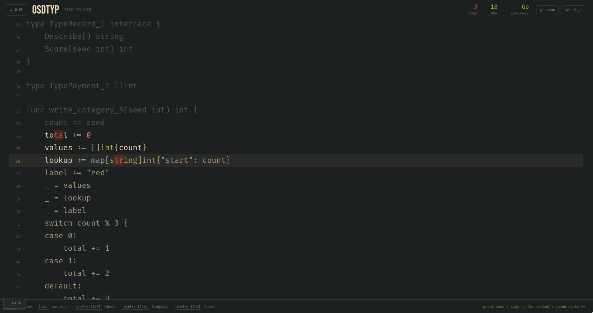

# OSDType

> **v0.0.1 · experimental.** This is the first public build. It is early,
> rough, and bugs are expected. Please report them through the in-app bug form
> (`/bugs`) with the steps and page where it happened.

Speedtyping, but for coders. A server-authoritative typing arena with ranked Elo,
multiplayer rooms, contests, bots and anti-cheat.



## V1 modes

- **Ranked** — Redis-backed matchmaking at 30s, 90s and 300s. Free-for-all
  pairwise Elo with divisions from Bronze to Grandmaster. A bot opponent is
  used when nobody else is queued.
- **Rooms** — public or private 2–16 player lobbies, six-character codes and
  invite links, optional passwords, owner/mod controls, kicks and bans.
- **Contests** — scheduled room events that open a lobby and start
  automatically. Funnels can include qualifiers, practice/warm-up stages,
  HotLaps and live finals. Enrolled players and spectators get a public
  timing tower with the top 10 and a username lookup. Results and final
  standings are persisted.
- **Practice and Zen** — unranked single-player typing with the same generated
  snippets used in every other mode. Practice runs are recorded, can be saved
  to profile history and shared as simulated replay links, and logged-in
  players can race adaptive Lewis/Max/Lance bots calibrated from recent form.
- **Results** — every finished run has a labelled speed graph and simulated
  replay. Ranked and room results combine every player on one exportable graph.

All matches are generated from the same language, seed and token count so the
server and browser produce byte-identical code. The backend owns the clock,
the start offset, scoring, presence, resume state and rating updates.
Anti-cheat flags are persisted and freeze the flagged player's rating change.

## Stack

- **Frontend:** SvelteKit, TypeScript, Tailwind
- **Backend:** Go, Gin, WebSockets
- **State and queueing:** Redis
- **Durable storage:** PostgreSQL
- **Code generation:** Rust (`resrap-rs` 1.0.0), served over HTTP and browser WASM

## Run locally

Prerequisites: Go 1.26+ and Node 22+. PostgreSQL 16 and Redis 7 must be
available on `5432` and `6379`; when Docker is installed, `make dev` starts
both containers for you. Rust is optional; without the codegen service the
server uses its built-in snippet fallback.

```sh
make dev
```

This starts PostgreSQL/Redis if needed, the Go API on
`http://localhost:8080`, and the Vite dev server on `http://localhost:5173`.
Dev login is enabled. Open `http://localhost:5173`.

For a production-style run:

```sh
make prod
```

This builds the SvelteKit app with `adapter-node`, compiles the Go API, and
starts the web server on `http://localhost:3000` with the API on `:8080`.
`DEV_LOGIN` is forced to `false`, so the login page only offers GitHub OAuth.
Ports can be changed with `WEB_PORT` and `API_PORT`. When the API is not at
`http://localhost:8080` for the browser, build with
`PUBLIC_API_URL=https://api.example.com make prod`.

If `make` is unavailable, run the scripts directly: `sh scripts/deps.sh`,
`sh scripts/dev.sh` or `sh scripts/prod.sh`. The manual path is still:

```sh
docker compose up -d postgres redis

# terminal 1: code generator (optional)
cd codegen && cargo run

# terminal 2: API and WebSocket server
cd server && go run .

# terminal 3: frontend
cd app && npm install && npm run dev
```

Open `http://localhost:5173`. Dev login is enabled by default; GitHub OAuth
needs `GITHUB_KEY` and `GITHUB_AUTH` in the server environment.

Guests can open the hub and play Practice or Zen without logging in. Those two
modes also keep working when the Go backend is not running; ranked, rooms,
contests, leaderboards and results are gated behind an account.

Use `localhost` rather than `127.0.0.1` for the frontend: auth cookies are
same-site and the dev server binds that origin.

## Docker

`make up` (or `docker compose up --build`) starts the whole application:
PostgreSQL, Redis, the Rust code generator, the Go API, and the adapter-node
SvelteKit web server. Open `http://localhost:3000`. The production-style stack
has `DEV_LOGIN=false`, so only GitHub OAuth is offered.

Set these variables for a real deployment:

```sh
PUBLIC_API_URL=https://api.example.com \
PUBLIC_ORIGIN=https://example.com \
FRONTEND_URL=https://example.com \
JWTKEY="$(openssl rand -hex 32)" \
GITHUB_KEY=... GITHUB_AUTH=... \
docker compose up --build -d
```

`PUBLIC_API_URL` is baked into the browser bundle at build time; the others
are runtime configuration. `JWTKEY` is mandatory in the production-style
stack and must be at least 32 characters; generate one with
`openssl rand -hex 32`. For local Docker development with the dev login
button, run `DEV_LOGIN=true JWTKEY=<local-dev-secret> docker compose up --build`.

Environment overrides understood by the server include `PORT`, `JWTKEY`,
`FRONTEND_URL`, `DEV_LOGIN`, `COOKIE_SECURE`, `COOKIE_SAMESITE`, `DB_HOST`,
`DB_PORT`, `DB_USER`, `DB_PASSWORD`, `DB_DBNAME`, `DATABASE_URL`, `DB_SSLMODE`,
`REDIS_ADDR`, `REDIS_URL`, `REDIS_TLS`, `CODEGEN_URL`, `BUG_WEBHOOK_URL`,
`METRICS_TOKEN`, `ADMIN_USERNAME`, `GITHUB_KEY`, `GITHUB_AUTH` and
`GITHUB_REDIRECT_URL`.

## AWS (current production)

For v0.0.1 the entire backend runs on one EC2 instance in `ap-southeast-2`
while Vercel serves the public static frontend:

- **API** — <https://api.15.134.14.153.sslip.io>
- **AWS web fallback** — <https://app.15.134.14.153.sslip.io>
- **Frontend** — <https://osdtype-w5vr-six.vercel.app/>
- **Stack** — `docker-compose.aws.yml` runs the Go API, PostgreSQL 17, Redis 7
  and Caddy on the instance. Postgres and Redis are private to the Compose
  network and persist in Docker volumes.
- **Images** — GitHub Actions builds ARM64 API/web images, pushes them to ECR,
  and deploys through SSM. The workflow is gated by `DEPLOY_ENABLED=true`.
- **Secrets** — `/osdtype/prod/env` in SSM Parameter Store. The local
  `.env.prod` is gitignored; never commit it.

The API is a single process because the hub, matchmaker, scheduler and active
game state live in-process. Keep it at one instance until that state moves out.
See [`DEPLOYMENT.md`](DEPLOYMENT.md) for the current AWS runbook. The Render
section below is legacy reference.

## Render

[](https://render.com/deploy?repo=https://github.com/ItsArnavSh/osdtype)

The repository includes a `render.yaml` Blueprint for a lightweight managed
deployment:

- **API** — native Go web service, always on. WebSockets, the matchmaker, the
  scheduler and active game runtimes live in this process, so keep it at one
  instance unless the hub is moved to Redis pub/sub.
- **Web** — static SvelteKit build served from Render's CDN. The SPA fallback
  is already configured.
- **Postgres** — Supabase's pooler. Use port `5432` (session mode) with
  `sslmode=require`; transaction mode on `6543` is not a good fit for GORM.
- **Redis** — the managed Redis URL. Use `rediss://` when the provider requires
  TLS; `REDIS_TLS=true` also works with a plain `redis://` URL.

Create the Blueprint from the Render Dashboard and fill the `sync: false`
values. The API must be on a paid always-on plan; Render's free web services
spin down after 15 minutes, which breaks WebSockets and scheduled contests.
The static site can stay free.

For the full platform-by-platform launch, DNS, Cloudflare/WAF and incident
response checklist, see [`DEPLOYMENT.md`](DEPLOYMENT.md).

Set these values:

```text
DATABASE_URL=postgresql://postgres.<project-ref>:<password>@aws-0-<region>.pooler.supabase.com:5432/postgres?sslmode=require
REDIS_URL=rediss://default:<password>@<host>:<port>
JWTKEY=<generated by Render>
FRONTEND_URL=https://<web-service>.onrender.com
GITHUB_KEY=<GitHub OAuth app client id>
GITHUB_AUTH=<GitHub OAuth app client secret>
GITHUB_REDIRECT_URL=https://<api-service>.onrender.com/auth/github/callback
VITE_API_URL=https://<api-service>.onrender.com
BUG_WEBHOOK_URL=<optional Discord or Slack webhook>
METRICS_TOKEN=<optional bearer token for /metrics>
ADMIN_USERNAME=ItsArnavSh
```

Percent-encode reserved characters in the Supabase password before putting it
in `DATABASE_URL` (for example, `@` becomes `%40`). `render.yaml` sets
`DB_SSLMODE=require`; the server also appends that mode when the URL omits
`sslmode`.

`render.yaml` sets `DEV_LOGIN=false`, `COOKIE_SECURE=true` and
`COOKIE_SAMESITE=none`. The last one matters on Render's default
`onrender.com` subdomains because they are separate sites; use `lax` if the web
and API are served from subdomains of one custom domain. The code generator is
disabled by default (`CODEGEN_URL=disabled`) so the Go fallback snippets are
used; point `CODEGEN_URL` at a deployed codegen service to restore the full
generator.

Do not commit database passwords, Redis passwords, OAuth secrets or webhook
URLs. Rotate any secret that has been pasted into chat or logs. The server
refuses to start with the development JWT key when `DEV_LOGIN=false` or
`GIN_MODE=release`; `JWTKEY` must be at least 32 characters. It also refuses
`COOKIE_SAMESITE=none` without `COOKIE_SECURE=true`.

## Bug reports

`/bugs` is a public report form. Signed-in reports are attached to the account
and listed under "your reports"; guests can leave an optional contact email.
Reports are stored in Postgres, rate-limited through Redis, and optionally
posted to `BUG_WEBHOOK_URL`. The API exposes `POST /bugs` and
`GET /bugs/mine`. Reports are plain text and should never contain passwords,
cookies or API keys.

## Admin console

Set `ADMIN_USERNAME` to the GitHub username that should own the instance. That
account is the primary admin; it can grant or revoke admin access for other
accounts from `/admin`. The route is deliberately hidden: every request from
an unauthenticated user, a normal player, or a revoked admin returns the same
`404` as an unknown page. Admins who are not the primary account can inspect
data but cannot change roles.

The dashboard has tabs for:

- **Overview** — active accounts this hour and over 24h, online sockets, queue
  size, account/game counts, open bugs and 24h uptime.
- **Bug reports** — full report details, submitter, request id, triage status
  and internal notes. Search by report id/title/text, filter by status,
  severity or category, and page through results. Updates are written to the
  audit trail.
- **Users** — search by username or numeric id, filter by role, and manage
  admin access. The primary admin is immutable and cannot be demoted.
- **Activity** — distinct active accounts per UTC hour for the last 24 hours,
  72 hours or 7 days.
- **Health** — current Postgres/Redis reachability, 24h uptime, failed checks
  and a paginated minute-level check history.
- **Logs** — recent structured process logs from the in-memory ring buffer,
  durable system events and privileged-action audit entries. Process logs are
  searchable by message/request/path, level and user (username or id); system
  events filter by level/kind and audits by actor/action.

Every admin list is server-paginated with `limit`, `offset`, `total`, `next`
and `has_more`; the UI never asks for the whole data set. Defaults and hard
caps are 50/100 for bugs and users, 100/200 for process logs, 50/200 for
events and audits, and 100/500 for health checks. Activity is capped at 168
hours. Offsets are capped at 100,000 to keep queries bounded.

Activity is recorded once per authenticated user per UTC hour. The first
request in an hour writes an `activity_hours` row; Redis throttles duplicate
writes. The API records a dependency health check every minute, stores the last
seven days in Redis so a Postgres outage remains visible after recovery, and
also writes a Postgres backup row when the database is reachable. Startup,
shutdown, dependency transitions and admin actions go to `system_events` and
`audit_logs`; Render remains the durable request-log sink.

## Security

Application hardening lives in the Go API and the static headers file:

- Security headers on every API response (`nosniff`, `DENY` framing,
  referrer policy, permissions policy, HSTS, a deny-all CSP for API payloads).
  `app/static/_headers` adds the same browser protections to the static site.
- A 1 MiB request-body cap and 10s header / 30s read timeouts; chunked bodies
  are capped with `http.MaxBytesReader`.
- Production startup validation rejects the development JWT secret and
  `SameSite=None` without `Secure` cookies.
- Auth cookies are `HttpOnly`, `Secure` in production, and scoped to the
  configured frontend. CORS is an explicit allowlist, not `*`.
- Admin routes return the same `404` for guests, normal players and revoked
  admins. Admin responses are `Cache-Control: no-store`; admin actions are
  audited.
- `/bugs` is rate-limited per IP and per account through Redis. `/metrics`
  supports a bearer token; use it in production.

The edge is the first line of defense: put Cloudflare (or an equivalent WAF)
in front of both Render services, enable managed WAF rules/bot protection, add
rate limits for `/auth/*`, `/bugs` and `/ws`, and keep `Always Use HTTPS` on.
Render also provides network-level DDoS protection for its services. Do not
rely on app-level limits alone; they are best-effort and share the API process.

Rotate the Supabase password, Redis password, GitHub OAuth secret and JWT key
if any of them were ever pasted into chat, logs or a commit. Rotating `JWTKEY`
logs every session out. Keep database and Redis TLS on, use Supabase backups
or PITR, and test a restore before launch. Never commit `.env`, `.prod-secret`
or provider credentials. The complete launch and incident-response checklist
is in [`DEPLOYMENT.md`](DEPLOYMENT.md).

## Observability

The API exposes three health/metrics endpoints:

- `GET /healthz` — liveness. Returns `200` while the process is running.
- `GET /readyz` — readiness. Checks Postgres and Redis, returning `503` if
  either dependency is unavailable.
- `GET /metrics` — Prometheus text exposition with request counts, status
  classes, latency totals, goroutines and heap usage. Set `METRICS_TOKEN` to
  require `Authorization: Bearer <token>`. Production should always set it;
  an empty token leaves the endpoint public.

Every response includes an `X-Request-ID` header, and request-scoped errors
include the same value as `request_id` in the JSON body. `LOG_FORMAT=json`
makes the API emit structured access logs with that request id, which Render
collects automatically. The bug form copies a failed request id into the
report when the API returns one.

For Render:

1. Enable deploy-failure and unhealthy-service notifications in the Render
   Dashboard.
2. Point an external uptime monitor (UptimeRobot, Better Stack, or a Render
   cron) at `https://<api-service>.onrender.com/readyz` every minute.
3. Optionally scrape `/metrics` from Grafana Cloud or another Prometheus
   instance. Use a long-lived `METRICS_TOKEN` and send it as a bearer token.
4. Watch Render's built-in CPU, memory and request metrics for the API service.
   Keep the service at one instance; the hub, matchmaker and scheduler are
   in-process.
5. Keep `ADMIN_USERNAME` set to the primary operator account. The `/admin`
   dashboard shows recent logs, bug reports, hourly activity and health; for a
   full database outage, Render's own service events and the external uptime
   monitor are the durable source of truth.

## Layout

```
app/       SvelteKit client, WASM code generator, game UI
codegen/   resrap-rs HTTP service (and parity wrapper)
server/    Go API, matchmaker, rooms, contests, game runtime
```

## Status

V1 is under active development. Infrastructure and database setup may evolve;
migrations run automatically when the server starts.
